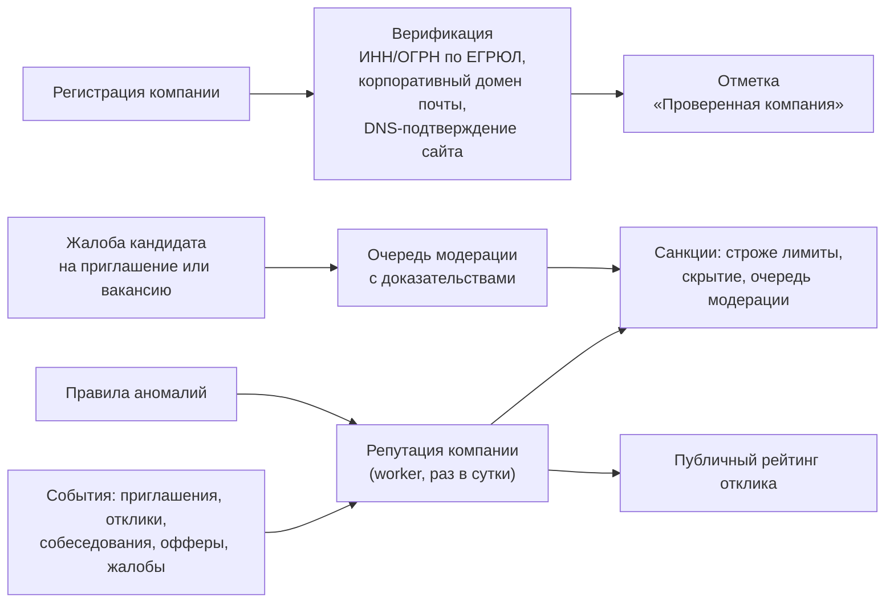
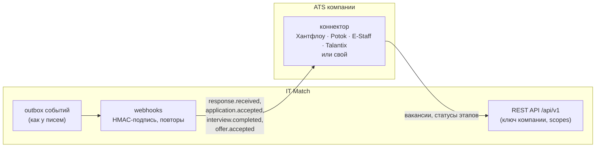

# Концепции за рамками MVP: защита от недобросовестных работодателей и интеграция с ATS

ТЗ ждёт здесь не реализацию, а архитектурный подход для доработки вместе с ФСП. Ниже — что уже есть
в коде как основа и что предлагается сверху.

## 1. Защита от фиктивных вакансий и недобросовестных работодателей

### Уже работает

| Мера | Где |
|---|---|
| Подтверждение почты при регистрации, согласие кандидата на передачу контактов | `services/account.py`, приглашения |
| Обязательная вилка «от–до» в вакансии и приглашении | схемы `SalaryRangeMixin`, `InvitationIn` |
| Контакты кандидата — только после его согласия, каждое раскрытие в журнале | `applications`, `contact_reveals`, аудит |
| Лимиты: 100 приглашений в сутки, пауза 30 дней после отказа, одно открытое обращение на пару | `core/ratelimit`, `services/applications` |
| Вакансия живёт 14 дней, потом продлевается или закрывается («призраки» не висят) | `vacancies.expires_at`, RLS |
| Модерация постфактум: блокировка компании, вакансии, пользователя с причиной | `/admin`, аудит |
| Премодерация компаний включается одной переменной | `COMPANY_PREMODERATION` |

### Предлагаемые слои

1. **Верификация компании**: ИНН/ОГРН сверяется с ЕГРЮЛ (открытый API ФНС), почта — на корпоративном
   домене, сайт подтверждается DNS TXT-записью. Проверенная компания получает отметку в приглашениях;
   кандидат может включить «тихий режим» — принимать приглашения только от проверенных.
2. **Репутация по поведению** (считает worker, хранится в `company_reputation`): доля ответов на отклики
   и срок ответа, конверсия «приглашение → собеседование → оффер», доля вакансий, закрытых наймом,
   жалобы. Публичный «рейтинг отклика» виден кандидату в приглашении.
3. **Правила аномалий**: массовые одинаковые приглашения; вилка далеко вне радара зарплат (данные уже
   есть, с k-анонимностью); раскрытие многих контактов без единого собеседования; вакансии без ответов
   месяцами; в текстах — просьбы оплатить обучение или прислать документы.
4. **Жалобы** (*реализовано для вакансий*): кнопка «Пожаловаться» в ленте вакансий — причина (фиктивная
   компания, неверная вилка, дискриминация, спам) и текст; модератор видит число жалоб и их текст, фильтр
   «С жалобами» в `/admin/vacancies`, блокирует вакансию с причиной в аудите. Дальше — жалобы на приглашения
   и доступ модератора к переписке по жалобе (break-glass с причиной, в аудите).
5. **Санкции по ступеням**: снижение лимитов → скрытие вакансий и приглашений → блокировка.

## 2. Интеграция с ATS работодателей

- **Исходящие события** — по образцу очереди писем (`outbox_messages`): `response.received`,
  `application.accepted`, `interview.completed`, `offer.accepted`. Доставка — webhook с HMAC-подписью,
  повторы с паузой, журнал доставки. Контакты кандидата попадают в событие только после его согласия.
- **Входящие вызовы** — тот же REST API: у компании ключи доступа (client credentials) со scopes
  `vacancies:write`, `applications:read`, `interviews:write`; сервисный принципал привязан к компании,
  поэтому `AccessPolicy` и RLS работают как для сотрудника.
- **Модель данных** проецируется на объекты ATS: вакансия → Job, анонимная карточка → Candidate
  (без ПДн до согласия), приглашение/отклик → Application, собеседование и оффер → этапы воронки.
- **Коннекторы** для популярных российских ATS — тонкие адаптеры поверх webhooks и API; для остальных —
  универсальный webhook и выгрузка CSV.

## 3. Несовершеннолетние участники

Среди участников соревнований ФСП много школьников. Поддержка несовершеннолетних — плюс, но не
обязательна для MVP; сейчас платформа рассчитана на совершеннолетних. Концепция:

- **Возраст.** При регистрации — дата рождения (не публикуется). До 14 лет аккаунт не создаётся;
  с 14 до 18 — «юниорский» профиль.
- **Согласие родителей.** Для обработки персональных данных несовершеннолетнего (152-ФЗ) — согласие
  законного представителя: письмо-подтверждение на почту родителя со ссылкой и копией согласия; до
  подтверждения профиль не попадает в каталог. Согласие отзывается так же, как согласие самого кандидата.
- **Ограничения по ТК РФ.** Трудовой договор с 15 лет — только на лёгкий труд (с 14 лет — с согласия
  родителя и органа опеки, в свободное от учёбы время), с сокращённой продолжительностью работы.
  Поэтому юниорский профиль видят только компании, отметившие вакансию как подходящую для
  несовершеннолетних (стажировка, part-time, без ночных смен и вредных условий); приглашения из
  остального каталога ему не приходят.
- **Конфиденциальность.** В анонимной карточке юниора не показываются город и образовательная
  организация; достижения ФСП — только уровень, без названий соревнований (как и сейчас).
- **Переход.** В 18 лет профиль становится обычным автоматически, согласие родителя больше не нужно.

## 4. Порядок внедрения

Слои внедряются по возрастанию стоимости и зависимости от внешних сторон: сначала то, что опирается на
уже собранные данные и не требует партнёров, затем внешние проверки, затем интеграции под конкретных
работодателей. Каждый этап включается отдельной настройкой, поэтому его можно выкатить на часть
компаний и отключить без отката базы.

1. **Репутация и жалобы на приглашения.** Данные для рейтинга отклика уже в базе: статусы приглашений,
   откликов и собеседований, жалобы на вакансии. Нужен ежесуточный расчёт в worker и показ рейтинга в
   приглашении; жалобы расширяются с вакансий на приглашения — та же таблица и тот же экран
   модерации. Внешних зависимостей нет.
2. **Верификация компаний и «тихий режим».** Проверка ИНН/ОГРН по ЕГРЮЛ через открытый API ФНС,
   корпоративный домен почты и DNS-подтверждение сайта дают отметку «Проверенная компания»; после
   этого кандидат может принимать приглашения только от проверенных. Правила аномалий сначала работают
   в режиме наблюдения — только отметка для модератора, автоматические санкции включаются после замера
   ложных срабатываний.
3. **Интеграция с ATS.** Исходящие webhooks из outbox и ключи компаний со scopes; пилот — с одним-двумя
   работодателями-партнёрами ФСП на универсальном webhook. Коннекторы под конкретные ATS (Хантфлоу,
   Potok, E-Staff, Talantix) — по запросам партнёров, когда формат событий проверен на пилоте.
4. **Юниорские профили.** Запускаются после юридической проверки формы согласия законного представителя
   и ограничений ТК РФ, вместе с ФСП, у которой есть данные об участниках-школьниках. Нужны дата
   рождения при регистрации, отдельное согласие родителя и отметка вакансии «подходит для
   несовершеннолетних».

| Этап | Срок | Зависит от | Критерий готовности |
|---|---|---|---|
| 1. Репутация и жалобы | 2–3 недели | ничего — данные уже собираются | рейтинг отклика есть в каждом приглашении; жалоба разбирается модератором за рабочий день |
| 2. Верификация и «тихий режим» | 3–4 недели | API ФНС; доступ компании к DNS сайта | отметка у проверенных компаний; ложных срабатываний правил аномалий меньше 5 % |
| 3. Интеграция с ATS | 4–6 недель на пилот | работодатель-партнёр с ATS | не меньше 99 % событий доставлено с учётом повторов; статусы в ATS совпадают с IT Match |
| 4. Юниорские профили | 4–6 недель после согласования | юристы и ФСП | юниорский профиль не виден вне вакансий для несовершеннолетних; без согласия родителя профиля нет в каталоге |

Сроки — оценка для команды из двух разработчиков; этапы 1 и 2 не зависят друг от друга и могут идти
параллельно. Критерии проверяются по уже имеющимся журналам (аудит, очередь `outbox_messages`,
статусы приглашений), отдельная аналитика не нужна.
