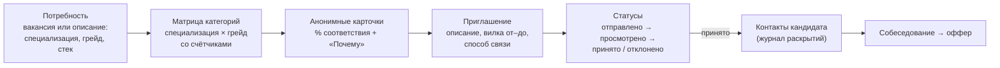

# Механика подбора и выхода на контакт

Смысловой центр продукта — **обратная механика**: инициативу проявляет работодатель. Он выбирает
категорию, видит анонимные карточки с объяснением соответствия и сам направляет приглашение
конкретному человеку — с описанием предложения и зарплатной вилкой. Отклик кандидата на вакансию
есть, но как дополнительный сценарий.

## 1. Путь работодателя

1. **Описание потребности.** Вакансия (или черновик) задаёт специализацию, грейд, стек, формат и
   вилку. По ней же система показывает пример теста — какие задания получат кандидаты.
2. **Подборка.** `GET /employer/catalog/categories` — матрица «специализация × грейд» с числом
   кандидатов (рамкой отмечены категории, рекомендованные под выбранную потребность: её грейд и
   соседние — те же, что получают баллы фактора «Категория»); `GET /employer/catalog/candidates` — карточки. Фильтры: категория, специализация, грейд,
   формат (кандидат может выбрать несколько), город из справочника (проходят и готовые к переезду),
   навыки (все указанные), только подтверждённые тестом, только с достижениями ФСП, категория ФСП,
   статус поиска. Фильтры меняют запрос, а не теряют подборку: выбранная вакансия и сортировка
   по соответствию сохраняются. Фильтры и выбранная потребность хранятся в адресе страницы, поэтому
   подборка не теряется при переходе по кабинету и кнопке «Назад», а ссылкой на неё можно поделиться.
3. **Приглашение без обязательной вакансии** (`POST /employer/applications`): должность, описание
   предложения, грейд, формат, город, вилка (обязательна, в рублях), способ связи; вакансия — по
   желанию (тогда поля заполняются из неё). Кандидат видит условия до начала общения.
4. **Статусы** видны обеим сторонам: `sent` → `viewed` (кандидат открыл список) → `accepted` /
   `declined`; ещё `withdrawn` (компания отозвала) и `expired` (14 дней без ответа). После отказа
   повторное приглашение той же компании — не раньше чем через 30 дней; одно открытое обращение на пару
   «компания — кандидат».
5. **Контакты** открываются только после согласия кандидата (принял приглашение или откликнулся сам):
   в момент согласия делается зашифрованный снимок имени и контактов, каждое раскрытие пишется в журнал.
6. **Дальше** — собеседование по принятому обращению и оффер с вилкой.

## 2. Ранжирование и объяснимость

Код: `backend/app/services/matching/` (паттерн Strategy — фактор = класс с весом и объяснением).

**Без вакансии — сила подтверждённого профиля внутри категории** (ТЗ: «выше те, у кого лучше
результаты тестирования и есть достижения ФСП»):

| Фактор | Вес | Что учитывает |
|---|---|---|
| Результат теста | 60 | баллы 0–100 внутри подтверждённой категории |
| Достижения ФСП | 25 | лучший уровень категорий ФСП (база / продвинутый / элита) |
| Актуальность | 15 | давность последней активности: тест, задача работодателя, профиль |

**Под вакансию — место в категории** (сортировка каталога по умолчанию, если у компании есть вакансия).
Порядок задают только подтверждённые данные:

1. **Категория** — группа в выдаче: та же специализация и подтверждённый тестом грейд против грейда
   вакансии (совпал → соседний → далёкий; без подтверждённого грейда — ниже всех подтверждённых).
2. **Внутри группы — тест и ФСП** с весами силы профиля: результат теста 60, ФСП 25, актуальность 15.
   Тест здесь — близость уровня к грейду вакансии: тест скорее занижает грейд, и «больше баллов —
   выше» поднимало в группе Middle настоящих Senior (раздел 3).

Стек, формат и город, зарплата и общие темы описания **на порядок не влияют**: в карточке они идут
блоком «Для сведения», а стек — фильтр каталога («Стек»: кандидаты со всеми выбранными навыками).
Так решили после разбора с экспертами 20.10: место кандидата отдаётся тесту и ФСП, а не
самоописанию.

Под оценкой в карточке — **одна строка «почему»**, например: «Грейд Middle подтверждён тестом и
совпадает с вакансией; Уровень по тесту ≈ Middle: совпадает с грейдом вакансии; Соревнования ФСП:
призёры и неоднократные финалисты». По кнопке «Почему» — вклад каждого фактора простыми словами.

Профиль без истории ФСП обрабатывается штатно: фактор ФСП даёт 0 с пояснением «Нет подтверждённых
результатов соревнований ФСП», кандидат **остаётся в выдаче** и ранжируется по тесту.

Лента вакансий кандидата (`/app/vacancies`) сортирует вакансии по соответствию 0–100 %: категория 30,
близость уровня по тесту 20, навыки 20, ФСП 10, описание 5, актуальность 5, формат и город 5,
зарплата 5 — там сравниваются вакансии для одного человека, и стек помогает найти подходящие.

### Второе мнение языковой модели

Под выбранную вакансию работодатель может нажать «Оценить с ИИ»: подключённая модель оценивает первых
10 кандидатов выдачи (0–100 % и довод одной фразой). Модели уходят только анонимные карточки — без
имени, контактов и текста «о себе»; содержимое передаётся как данные, ответ ограничен JSON-схемой.
Оценка показывается рядом с объяснимой оценкой и не меняет порядок: ранжирование остаётся
объяснимым и воспроизводимым, а модель помогает заметить то, что факторы не видят (например,
близкий стек под другим названием). Код: `backend/app/services/ai_assist.py`.

## 3. Как изменилась формула после оценки

Первая версия давала фактору теста «чем больше баллов, тем лучше» и под вакансию. Процедура оценки
([validation.md](validation.md)) показала, что так для вакансии Middle наверх выходят кандидаты уровнем
выше: Precision@10 было 53,8 % — ниже выдачи по резюме (58 %). Фактор теста под вакансию стал мерой
близости уровня к её грейду — Precision@10 выросла до 74,8 %, nDCG@10 — с 0,66 до 0,84. После того как
тест стал строиться по стеку кандидата, Precision@10 — 77,5 % против 64,8 % у выдачи по резюме.
После разбора с экспертами (20.10) стек перестал влиять на порядок и стал фильтром: Precision@10 на
трёх выборках — 73,8–76,2 % против 54,5–66,2 % у выдачи по резюме (validation.md, раздел 5).

## 4. Производительность

Рейтинг категории считается одним проходом и кэшируется на 60 с с версией каталога (число профилей и
время последнего изменения): изменение любого профиля сбрасывает кэш. Нагрузочный тест k6 — 420 запросов
в секунду, p95 73 мс на 4 процессах api (README, «Нагрузка и масштабирование»).

## 5. Конфиденциальность

- Работодатель видит анонимную карточку: идентификатор, категорию, навыки, тест, ФСП, город, формат;
  имя и контакты — только после согласия кандидата.
- Кандидат управляет видимостью: ожидания по зарплате, достижения ФСП и «о себе» можно скрыть —
  скрытое не участвует в подборе и не раскрывается.
- Статус «Не ищу» убирает профиль из каталога.
- Согласие на обработку и публикацию данных даётся при регистрации; его дата видна в настройках
  приватности (`GET /auth/me` → `consent_at`). Снять профиль с публикации — «Скрыть профиль от
  работодателей», отозвать согласие — удаление аккаунта (`POST /candidate/account/delete`).
